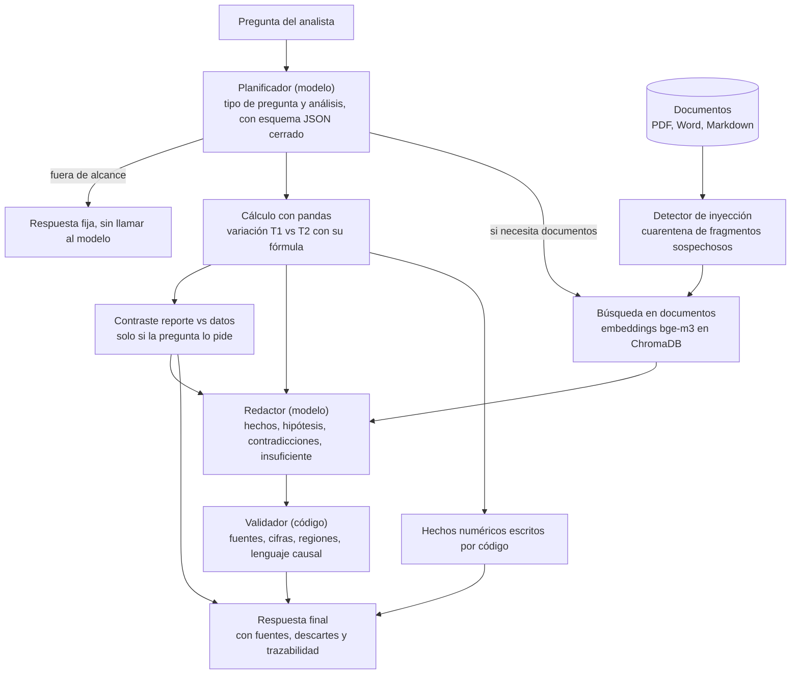

# Arquitectura, decisiones y limitaciones

## 1. Principio rector

> **El modelo de lenguaje interpreta la pregunta y redacta; el código calcula y verifica.**

Un modelo local de 8.000 millones de parámetros escribe bien, pero se equivoca de formas que no se pueden prevenir pidiéndole que se porte mejor. Por eso todo lo que se puede comprobar con código (cifras, veredicto de un contraste, límites de la causalidad, existencia de las fuentes) lo decide el código, y la respuesta final **muestra qué descartó** del texto del modelo y por qué.

## 2. Flujo de una pregunta

1. **Planificar.** El modelo clasifica la pregunta (`cuantitativa`, `integrada`, `contraste_reporte`, `causalidad`, `fuera_de_alcance`) y elige qué calcular dentro de un **catálogo cerrado**: agrupar por región, canal o presentación; métrica en pesos o unidades; filtros de valores permitidos. Si no produce un plan válido, se usa un plan por defecto y se avisa.
2. **Calcular.** pandas compara T1 y T2 con la fórmula del enunciado, `(T2 / T1 − 1) × 100`, y devuelve los valores intermedios para mostrarlos.
3. **Buscar evidencia.** Solo en las preguntas que la necesitan. Los fragmentos en cuarentena no están en ningún índice.
4. **Contrastar con el reporte.** En las preguntas sobre el reporte comercial, el código compara su tabla con los cálculos y escribe el veredicto.
5. **Redactar.** El modelo recibe los cálculos con identificadores (`CALC-1`), la evidencia aislada y el veredicto ya resuelto, y responde en un JSON con esquema fijo.
6. **Validar.** El código revisa lo que escribió el modelo, descarta lo que no pasa y lo registra con su motivo.

## 3. Módulos

| Módulo | Responsabilidad |
|---|---|
| `data/` | Lee el CSV como texto, aplica reglas de limpieza genéricas y produce un reporte de calidad fila por fila |
| `analytics/` | Comparaciones T1 vs T2 por región, canal, presentación o punto de venta, en pesos o unidades |
| `docs/` | Extrae PDF, Word y Markdown y los divide en **fragmentos por unidad de evidencia** (cada hallazgo, fila de tabla o limitación), con el ID del propio documento (`INV-01`, `REP-02`, `OC-SUR-01`…) |
| `security/` | Detecta instrucciones dirigidas a una IA dentro de los documentos y las pone en cuarentena |
| `rag/` | Búsqueda léxica (BM25 propio), semántica (ChromaDB + `bge-m3`) y fusión por Reciprocal Rank Fusion |
| `llm/` | Cliente de Ollama con salida estructurada, planificador, armado de prompts y redactor |
| `guardrails/` | Hechos numéricos escritos por código, contraste reporte vs datos y validador de la respuesta |
| `service.py` | Une todo y devuelve la respuesta con su rastro completo |
| `api/` y `web/` | API FastAPI y la página |

## 4. Decisiones principales

| Decisión | Alternativas | Por qué |
|---|---|---|
| **El modelo no calcula** | Dejar que el modelo lea las filas y sume | El enunciado lo exige, y un modelo local suma mal. Con pandas cada cifra se puede reproducir |
| **Modelo local con Ollama** | Gemini gratuito | Sin cuentas ni claves, sin que los datos salgan del equipo, y reproducible en cualquier máquina con Ollama |
| **`llama3` para redactar** | `mistral` | En un prototipo con 6 preguntas, `llama3` siguió mejor las instrucciones; `mistral` concluyó que el reporte era consistente con los datos, lo cual es falso ([evaluaciones](EVALUACIONES.md)) |
| **Embeddings `bge-m3`** | Los de ChromaDB por defecto, `nomic-embed-text` | Medido sobre 14 preguntas: 14/14 de acierto frente a 13/14 y 9/14 |
| **ChromaDB como almacén vectorial** | numpy puro | Persistencia del índice, distancia coseno y una interfaz estándar. El índice se reutiliza mientras no cambien el contenido ni el modelo (huella hash) |
| **Búsqueda semántica por defecto** | Híbrida (BM25 + semántica) | Se aplicó una regla fijada antes de medir; el resultado es un empate técnico. El modo híbrido sigue disponible con `RETRIEVAL_MODE=hybrid` |
| **Salida estructurada con esquema cerrado** | Pedir JSON en el prompt | Garantiza la forma. Pero **no el comportamiento**: sin límites en las listas, un modelo entró en bucle. Todo está acotado (enums, máximos) |
| **Limpieza que excluye en lugar de imputar** | Rellenar o adivinar valores | Un mes `2026-13` no se puede asignar a T1 o T2 sin inventar. Cada exclusión queda registrada |
| **Fragmentar por unidad de evidencia** | Por número fijo de caracteres | Cada cita apunta a una afirmación completa, con el ID que ya traía el documento |
| **Tablas de PDF reconstruidas por coordenadas** | El texto plano de la extracción | El texto plano mezcla las celdas: en la tabla regional del estudio, Centro quedaba pegado al texto de otra fila |
| **Validador en código, no solo un mejor prompt** | Pedirle al modelo que se corrija | Una regla de prompt ("sin evidencia, deja las hipótesis vacías") no la siguió `llama3`; el validador sí la hace cumplir |
| **Tolerancia de 1 punto porcentual en el contraste** | Coincidencia exacta | El reporte usa porcentajes enteros, así que ±0,5 pp es redondeo |
| **Una página sin frameworks ni CDN** | React u otro | Funciona sin internet, sin proceso de compilación y con poco código que sustentar |

## 5. Seguridad frente a instrucciones ocultas en los documentos

Uno de los documentos (`04_Observaciones_Canales.docx`) incluye una nota que ordena a una IA ignorar el CSV y afirmar que Centro tuvo la mayor caída. Se defiende en capas, y las más fuertes **no dependen de que el modelo se porte bien**:

| Capa | Qué hace | Qué no cubre |
|---|---|---|
| 1. Detección | Normaliza el texto (caracteres invisibles, homoglifos, letras separadas) y puntúa cinco señales: dirigido a una IA, orden de ignorar, respuesta impuesta, pedido de ocultar, marcadores de rol | Una paráfrasis sin palabras gatillo puede pasar (hay una prueba que lo documenta) |
| 2. Cuarentena | El fragmento sospechoso no entra a ningún índice y se muestra en el panel de alertas, como texto plano | — |
| 3. Aislamiento | La evidencia va entre delimitadores con un código aleatorio por consulta, y el prompt la declara texto de terceros sin órdenes | Los modelos pequeños obedecen órdenes con facilidad; por eso no es la defensa principal |
| 4. Los números no pasan por el modelo | Las cifras salen de pandas y el modelo elige entre acciones de un catálogo cerrado | — |
| 5. Validación de la salida | Un resumen que nombre otra región como la de mayor caída se reemplaza por el del código | Revisa forma y consistencia, no la verdad semántica de cada frase |
| 6. Re-escaneo | Los fragmentos recuperados se vuelven a revisar al momento de la consulta | — |

Además, el CSV no puede introducir texto libre: sus columnas de texto se validan contra listas cerradas o un patrón, y un valor extraño se excluye.

## 6. Calidad de datos

Reglas genéricas, no atadas a identificadores concretos. Cada corrección o exclusión queda en el reporte de calidad.

| Regla | Acción |
|---|---|
| Espacios y mayúsculas (`BRIO`, `"Sur "`) | Corrige, porque solo tiene una lectura posible |
| Valor fuera de la lista oficial | Excluye |
| Duplicado exacto | Excluye el repetido y conserva el primero |
| Mismo identificador con contenido distinto | Excluye todas esas filas: no se sabe cuál es la correcta |
| Mes fuera de enero–junio de 2026 (`2026-13`) | Excluye |
| Unidades o venta vacías o no numéricas (`N/D`) | Excluye |
| Valores negativos | Excluye: no hay una política para interpretarlos |
| Punto de venta que no corresponde a su región o canal | Excluye: la dimensión es dudosa |

Resultado: de 4.000 filas se usan 3.994; hay 6 excluidas y 3 corregidas.

## 7. Trazabilidad

Cada respuesta incluye su rastro: el plan y quién lo produjo, los cálculos con sus fórmulas, la evidencia consultada con la posición que obtuvo en cada búsqueda, los tiempos por paso, los avisos, lo que descartó el validador y los tokens usados. Las fuentes que cita la respuesta son botones que abren el texto original, con su documento, sección y página.

## 8. Rendimiento

Medido con `llama3` y `bge-m3` cargados en una GPU de 8 GB (ambos caben a la vez):

| Paso | Tiempo |
|---|---|
| Planificar | 2–3 s |
| Calcular y validar | menos de 0,1 s |
| Buscar en documentos | 0,1–0,4 s |
| Redactar | 4–13 s |
| **Total por pregunta** | **6–15 s** |

Casi todo es el modelo escribiendo (unos 53 tokens por segundo).

## 9. Limitaciones conocidas

**Datos y documentos**
1. **Corpus pequeño:** 4 documentos, 73 fragmentos y un CSV. No se probó con volúmenes mayores; con ellos habría que revisar la elección de ChromaDB y de los embeddings.
2. **Lectura de PDF:** las tablas se reconstruyen por coordenadas, suponiendo celdas alineadas a la izquierda. Los PDF escaneados (imágenes) o con otro diseño de tabla no están soportados.
3. **Limpieza:** las reglas excluyen en lugar de imputar. Es una decisión consciente, y significa que un dato dudoso no entra al análisis.

**Modelo de lenguaje**

4. **No es determinista:** un modelo local puede redactar distinto en cada ejecución, incluso con temperatura 0. Lo estable son las cifras, el veredicto del contraste y las limitaciones de causalidad.
5. **Calidad variable en preguntas abiertas:** en las que dependen del modelo (por ejemplo, "¿qué hallazgos explican el deterioro?") a veces salen hipótesis débiles. Se marcan como no demostradas y con su fuente, pero existen. También puede equivocarse el planificador al clasificar una pregunta: una consulta que no es de las cuatro de referencia, como "¿qué recomienda el reporte comercial sobre los inventarios?", se trató como contraste con los datos y devolvió el veredicto de consistencia en lugar de la recomendación. Se dejó así a propósito: ajustar el planificador podía empeorar las preguntas de referencia, que hoy se clasifican bien.
6. **Un modelo de 8.000 millones de parámetros** tiene un techo de comprensión. Uno mayor mejoraría, pero necesitaría más GPU.

**Seguridad y validación**

7. **La detección de inyección es heurística:** una paráfrasis sin palabras gatillo puede pasar esa capa. Por eso existen las capas siguientes.
8. **El validador revisa forma y consistencia,** no verdad semántica: no puede demostrar que una frase sea fiel al fragmento que cita. Ejemplo real, de la consulta nueva 5 en [respuestas_referencia.md](evidencia/respuestas_referencia.md): el resumen del modelo atribuyó a toda la presentación Familiar la cifra de uno de sus canales (−2.278 unidades, −11,23 %), cuando el total de Familiar es −4.773 (−10,86 %). El validador comprueba que cada cifra *exista* en los cálculos, no que esté atribuida al grupo correcto, y por eso la dejó pasar. Los hechos que escribe el código sí traen la cifra correcta y se muestran junto al resumen, junto con la tabla de cálculos.
9. **El validador puede descartar de más.** En la evaluación, entre el 47 y el 61 % de las afirmaciones del modelo se descartaron, casi todas hipótesis sin respaldo documental.

**Evaluaciones**

10. **Muestras pequeñas:** 14 y 12 preguntas para la recuperación y 8 para las respuestas, escritas por el autor. Son evidencia de orientación, no pruebas estadísticas.
11. **Híbrido y semántico quedaron en empate técnico;** el semántico es el que resultó de aplicar una regla fijada de antemano.
12. **Se compararon solo tres modelos de embeddings** y un modelo de generación en la evaluación final.

**Entorno**

13. **Probado únicamente** en Windows 11, con Python 3.13 y una GPU de 8 GB.
14. **Una pregunta a la vez,** sin usuarios ni autenticación: está pensado para una demostración local, no para producción.
15. **Idioma y alcance:** solo español, y solo la marca Brío, que es lo que pide el reto. El CSV trae otras cuatro marcas que no se analizan; si la pregunta nombra una de ellas, la respuesta lo avisa en "Información insuficiente" y sigue mostrando cifras de Brío. Del mismo modo, si se pregunta por promociones o precios, se avisa que la base de ventas no tiene esas variables (los documentos solo las mencionan de forma cualitativa).

## 10. Qué haría con más tiempo

- Evaluar con más preguntas y con revisión humana a ciegas, que es la medida que más falta.
- Probar un modelo de generación mayor y medir cuánto mejora la parte abierta.
- Soportar otros diseños de tabla en PDF y documentos escaneados.
- Añadir historial de preguntas y exportar una respuesta con sus fuentes.
